# FMCG Promotion Effectiveness & Customer Growth Analytics

> A validated portfolio project that extends a retail revenue-growth baseline into a reproducible SQL/Python workflow for customer segmentation, quasi-experimental promotion evaluation and budget decisions.


## Project Positioning

This repository is an independently developed portfolio extension of the MIT-licensed project [`medhanshrajdeo/revenue-growth-analytics`](https://github.com/medhanshrajdeo/revenue-growth-analytics).

The imported baseline provides a Python workflow for beverage filtering, descriptive promotion lift, rule-based household segmentation, commercial KPIs and directional what-if scenarios. My extension focuses on the analytical gaps that matter in a Data Analyst, Business Analyst or Consumer Insights interview:

- a reproducible BigQuery SQL analytical layer;
- a household-level Customer 360 table;
- RFM, cohort retention and validated K-Means segmentation;
- matched Difference-in-Differences and event-study diagnostics;
- robustness, placebo and sensitivity checks;
- a redesigned four-page Power BI decision dashboard.

See [PROJECT_PLAN.md](PROJECT_PLAN.md) for the delivery plan,
[PROJECT_DEVELOPMENT_LOG.md](docs/PROJECT_DEVELOPMENT_LOG.md)
for the implementation and release record, and
[THIRD_PARTY_NOTICES.md](THIRD_PARTY_NOTICES.md) for attribution.

## Current Status

| Workstream | Status | Evidence |
|---|---|---|
| Baseline provenance and clean release snapshot | Complete | Project plan, third-party notice and fresh repository history |
| Attribution and project scope | Complete | Project plan and third-party notice |
| Obtain raw dunnhumby data | Complete locally | Raw files are intentionally not distributed |
| Reproduce and validate baseline results | Complete locally | End-to-end pipeline executed; current-schema fix recorded |
| BigQuery SQL analytical layer | Complete | Six GoogleSQL scripts executed in BigQuery Sandbox on 2026-10-21; source contract, quality checks and analysis marts validated |
| Customer 360 and RFM analysis | Complete | Code, data dictionary, quality checks and aggregate outputs |
| Cohort retention analysis | Complete | Censoring-aware long table, matrices, charts and checks |
| K-Means segmentation and stability checks | Complete | Model selection, seed/time-window stability, profiles and checks |
| Matching, DiD and event study | Complete | 423 matched events, balance, pre-trend and placebo evidence |
| Commercial decision and ROI scenario layer | Complete | Coupon, category, SKU, KPI and assumption tables |
| Power BI decision dashboard | Complete | Four-page PBIP report in `powerbi/` |

## Business Question

How should an FMCG manufacturer or grocery retailer allocate a limited promotion budget across products, stores and customer segments?

The analysis is designed to separate three different questions:

1. **Description:** What happened during promoted and non-promoted periods?
2. **Incrementality:** How much of the change is plausibly attributable to the promotion?
3. **Decision:** Which promotions should be expanded, redesigned or stopped under explicit budget and margin assumptions?

## Dataset

The project uses the dunnhumby **Complete Journey** dataset, which represents approximately two years of household-level grocery activity for 2,500 frequent-shopper households. It includes transactions, product hierarchy, stores, campaigns, coupons, redemptions, display/mailer indicators and partial household demographics.

Official source: [dunnhumby Source Files](https://www.dunnhumby.com/source-files/)

Raw, household-level, transaction-level, product-dimension and SKU-level data
extracts are not intended for the public release. Download the dataset from the
official source and place the expected CSV files in `data/raw/`. The repository
publishes code, methods, charts, validation records and small analytical
aggregates; see [THIRD_PARTY_NOTICES.md](THIRD_PARTY_NOTICES.md) for the
conservative redistribution boundary.

## Analytical Roadmap

### 1. Reproducible Data Foundation

- document table grain, primary keys and joins;
- create BigQuery source-contract, quality-control and analytical tables;
- test row counts, uniqueness, missingness and invalid values;
- build product-store-week and household-level datasets;
- record every reproduction difference from the imported baseline.

### 2. Customer 360 and Segmentation

- calculate Recency, Frequency and Monetary features — **complete**;
- measure basket value, active weeks, purchase intervals and category breadth;
- build customer and revenue cohort-retention matrices;
- compare rule-based RFM segments with K-Means clusters — **complete**;
- test cluster stability across seeds and time windows — **complete**.

## Independent Extension 1: Customer 360 and RFM

`src/customer_360.py` builds one row per household from the independently
reproduced transaction pipeline. It combines full-store RFM measures, shopping
cadence, category breadth, discount and coupon behaviour, beverage engagement
and the partial anonymised demographics in the current official data release.

The implementation includes eight automated checks covering household grain,
key completeness, recency and frequency validity, RFM completeness and exact
reconciliation to source transaction revenue. All checks pass on the local
2,500-household dataset; see
[`outputs/validation/customer_360_quality.csv`](outputs/validation/customer_360_quality.csv).

Selected descriptive findings:

- **Champions:** 506 households (20.2%) contribute 45.2% of observed revenue.
- **High-Value Loyal:** 677 households (27.1%) contribute 58.6% of revenue.
- **High-Value At Risk:** 183 households (7.3%) contribute 10.6% of revenue.
- **Low-Frequency Customers:** 974 households (39.0%) contribute 11.6% of revenue.
- **Promotion-Oriented Customers:** 59 households meet a deliberately strict
  behavioural proxy based on top-quartile discount-basket rate and at-least-
  median shopping frequency.

These labels describe observed behaviour within this retailer and time window.
In particular, promotion-oriented behaviour is not proof of underlying price
sensitivity or a causal promotion response.

Reproduce the extension after running the imported baseline:

```powershell
python -m src.customer_360
```

The household-level Customer 360 CSV is written to the Git-ignored
`data/local_exports/` directory for local Power BI use. Only aggregate RFM and
persona summaries are committed. Field definitions and limitations are in
[`docs/CUSTOMER_360_DATA_DICTIONARY.md`](docs/CUSTOMER_360_DATA_DICTIONARY.md).

## Independent Extension 2: Cohort Retention

`src/cohort_retention.py` groups households by their first observed purchase in
fixed 30-day periods. It creates a complete observable cohort-age panel, fills
genuine zero-activity cells with zero, and leaves future unobservable cells
missing rather than misclassifying them as churn.

Nine automated checks pass, including household-count reconciliation, 100%
age-zero retention, valid retention bounds, censoring logic and exact revenue
reconciliation. Only four cohorts contain at least 30 households; seven tiny
later cohorts remain in the audit table but are excluded from visual comparison.

Across comparable non-P00 cohorts, approximately **81.1%** of households remain
active at cohort age 12. Customer retention is stable near 80% after the initial
drop, consistent with the dataset's frequent-shopper sampling frame.

The unadjusted revenue index exceeds 100%, but this is not presented as organic
growth: age zero is often a partial 30-day period and later values also reflect
survivor composition.

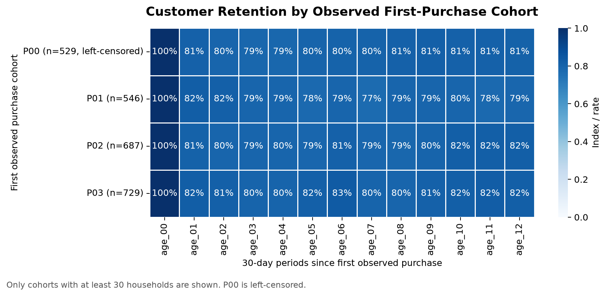

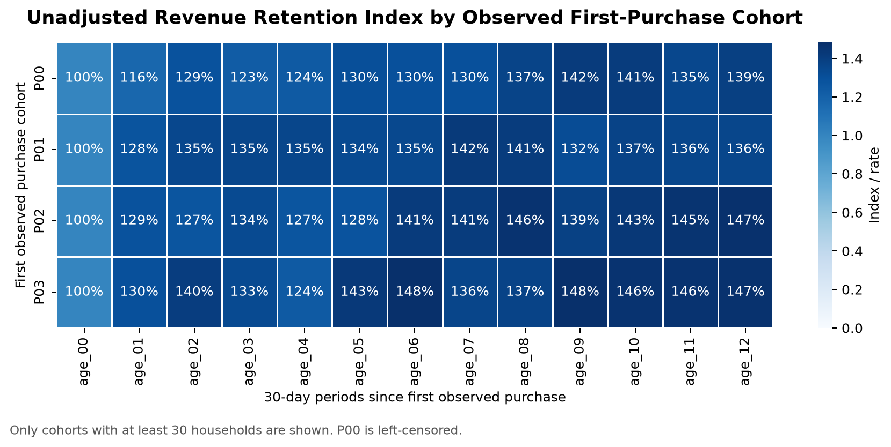

Reproduce the cohort outputs with:

```powershell
python -m src.cohort_retention
```

Method, censoring rules and limitations are documented in
[`docs/COHORT_RETENTION_METHOD.md`](docs/COHORT_RETENTION_METHOD.md).

## Independent Extension 3: Validated K-Means Segmentation

`src/kmeans_segmentation.py` compares K=2 through K=8 using silhouette,
Calinski-Harabasz, Davies-Bouldin, inertia and repeated-seed stability. K=2 has
the strongest raw separation but produces an overly coarse high/low split. K=3
is selected as the smallest decision-useful solution: its mean silhouette is
0.1745 and its mean pairwise Adjusted Rand Index across five seeds is 0.9963.

The final solution covers all 2,500 households and produces three interpretable
groups:

- **High-Value Frequent:** 1,129 households (45.2%) generate 79.0% of revenue.
- **Developing Occasional:** 967 households (38.7%) generate 19.3% of revenue.
- **Dormant Low-Value:** 404 households (16.2%) generate 1.8% of revenue.

An 80%-history versus full-history robustness test produces an Adjusted Rand
Index of 0.6905 across 2,498 common households. This is evidence of moderate,
not perfect, time-window stability. Discount, coupon and beverage-promotion
rates are also too similar across clusters to justify calling any cluster
"price sensitive"; promotion orientation remains a separate behavioural proxy.

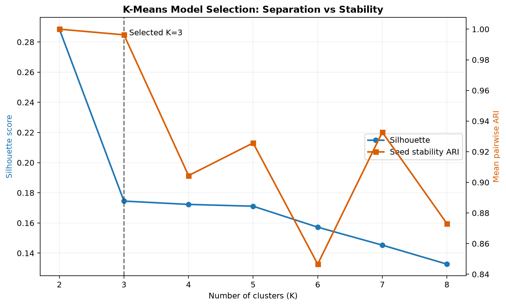

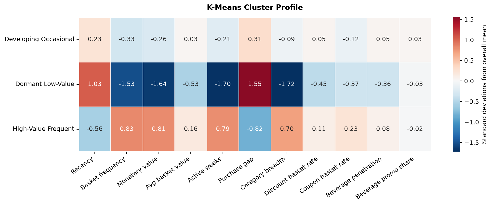

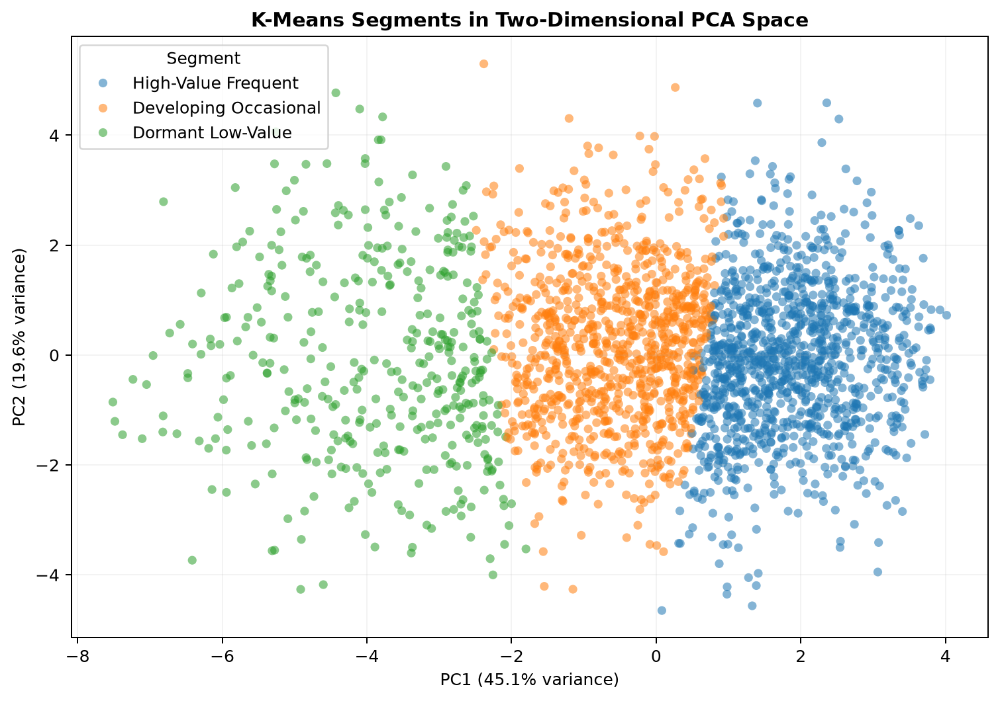

All nine final-segmentation quality checks and all three stability checks pass.
The household-level assignment file remains local and Git-ignored; the public
repository contains the aggregate cluster profile, RFM cross-tab, charts and
validation evidence.

Reproduce the segmentation with:

```powershell
python -m src.kmeans_segmentation
```

Feature preparation, model-selection logic, naming rules and limitations are
documented in
[`docs/KMEANS_SEGMENTATION_METHOD.md`](docs/KMEANS_SEGMENTATION_METHOD.md).

### 3. Promotion Effectiveness

The imported baseline compares promoted and non-promoted unit velocity. That measure is descriptive and may be affected by seasonality, product selection, store differences and pre-existing trends.

The independent extension now:

- constructs a product-store-week event panel;
- defines isolated display/mailer episodes with four-week pre/post windows;
- matches treated events to same-category unexposed controls;
- reports covariate balance and applies a common-support caliper;
- estimates matched Difference-in-Differences effects;
- visualises event-time coefficients and tests pre-trends;
- runs placebo, strict-match and outlier sensitivity checks.

## Independent Extension 4: Matched Promotion Evaluation

`src/causal_promotion_evaluation.py` evaluates isolated one-week display or
mailer exposures. It restricts the analysis to 326 sufficiently observed
beverage SKUs, constructs clean nine-week event windows and matches treated
product-store events to unexposed same-category controls using the complete
four-week pre-period path, revenue, trend, activity and realised price.

The final sample contains **423 events across 139 treated SKUs**. Matching
reduces the maximum absolute standardised mean difference from 0.421 to 0.099.
The product-level pre-trend slope test (p=0.442) and pre-period placebo
(p=0.335) do not indicate a systematic pre-treatment divergence.

The matched DiD estimate is approximately **+0.36 units** per product-store
event (95% cluster-bootstrap CI: +0.14 to +0.65) and **+$0.55 revenue**
(95% CI: +$0.19 to +$0.98) in the exposure week. The relative estimate is about
45%, but this reflects a low product-store weekly baseline; the modest absolute
increment is more useful for budget decisions. The estimate remains positive
after outlier winsorisation (+0.25 units) and under a stricter matching-distance
rule (+0.23 units; 95% CI: +0.07 to +0.39). Post-event intervals cross zero, so
there is no reliable evidence of a persistent effect.

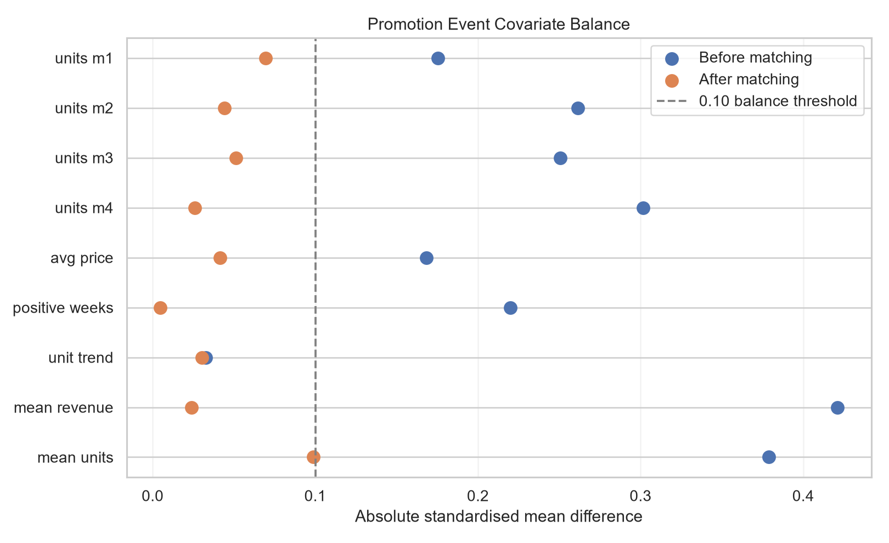

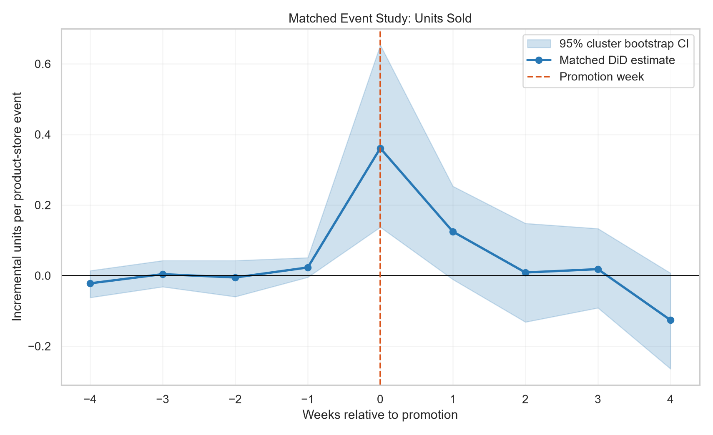

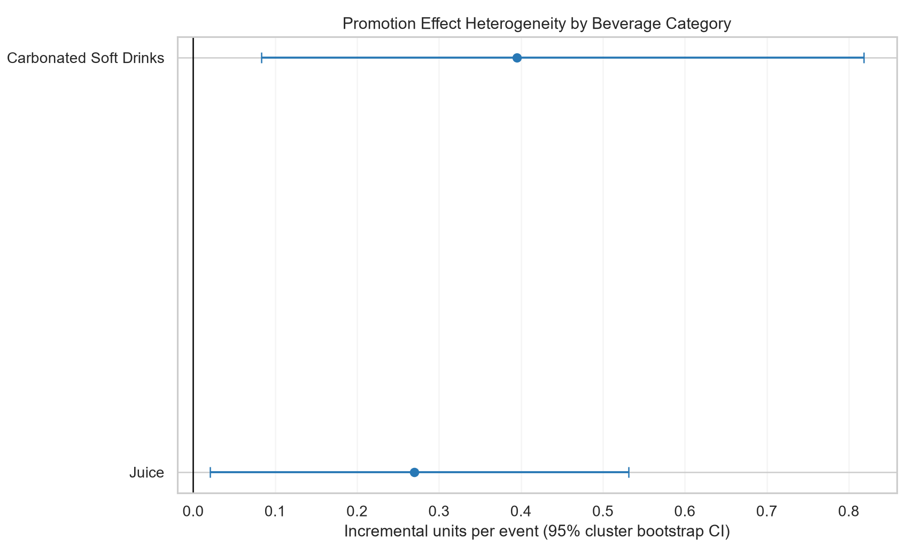

Reproduce the extension with:

```powershell
python -m src.causal_promotion_evaluation
```

Treatment construction, matching, estimation, diagnostics and limitations are
documented in
[`docs/PROMOTION_CAUSAL_METHOD.md`](docs/PROMOTION_CAUSAL_METHOD.md).

### 4. Commercial Decision Layer

- translate model estimates into incremental units and revenue ranges — **complete**;
- compare category, SKU and customer-segment evidence — **complete**;
- distinguish observed facts, estimated effects and business assumptions — **complete**;
- model budget scenarios under explicit gross-margin, execution-cost and scaling assumptions — **complete**.

## Independent Extension 5: Commercial Decision Layer

`src/commercial_decision_layer.py` produces Power BI-ready decision tables and
labels every metric as observed behaviour, a quasi-experimental estimate or an
assumption-only scenario.

The coupon analysis corrects an important denominator problem: the 124,548
coupon-table rows are product eligibility mappings, not issued coupons. Using
7,208 targeted household-campaign exposures, the valid observed redemption
penetration is **12.33%**. Targeting is heavily concentrated among High-Value
Frequent customers, whose exposure-level redemption penetration is 13.78%,
versus 4.13% for Developing Occasional customers. This remains descriptive,
because targeting itself is not random.

Carbonated soft drinks contribute 59.2% of beverage sales and show +0.39
matched incremental units per event; juice contributes 22.8% and shows +0.27.
Both warrant controlled expansion tests. Five smaller categories are labelled
as needing more causal evidence rather than being ranked using descriptive lift
alone.

The ROI table contains 243 explicitly hypothetical combinations of causal
effect case, margin, execution cost, panel-to-total scaling and budget. With the
base revenue estimate, 30% margin and $5 cost per event, the required
panel-to-total multiplier is approximately 30.5 just to break even. This is an
assumption threshold, not an observed ROI.

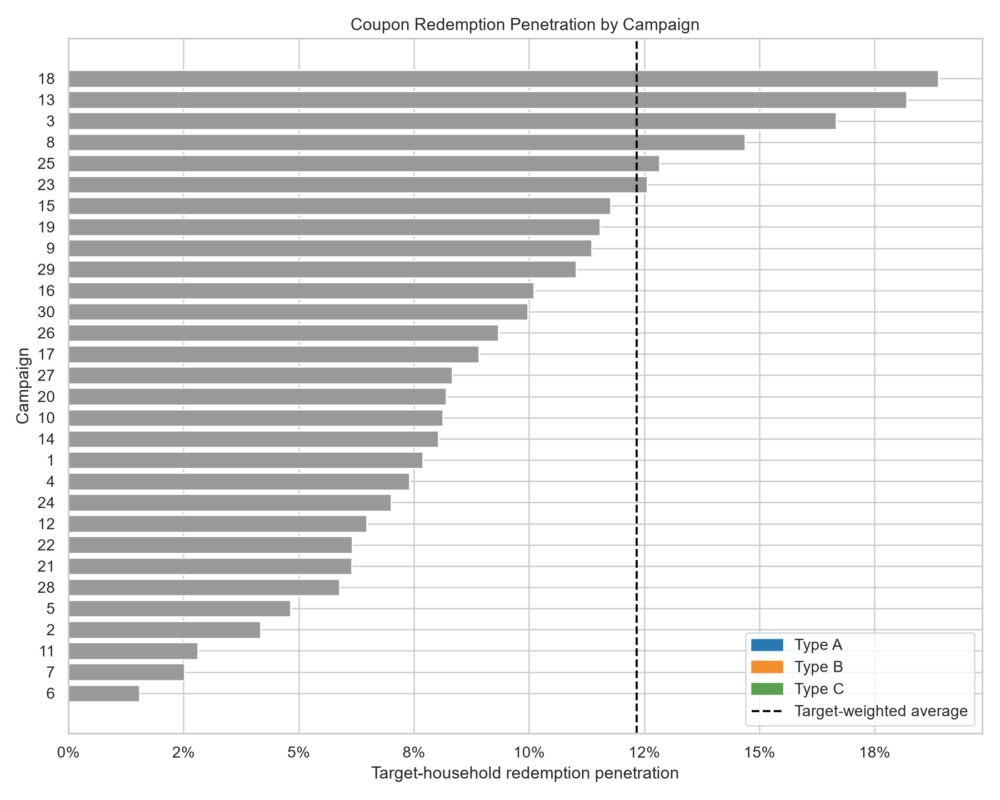

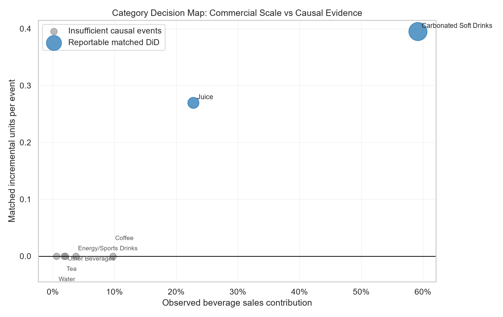

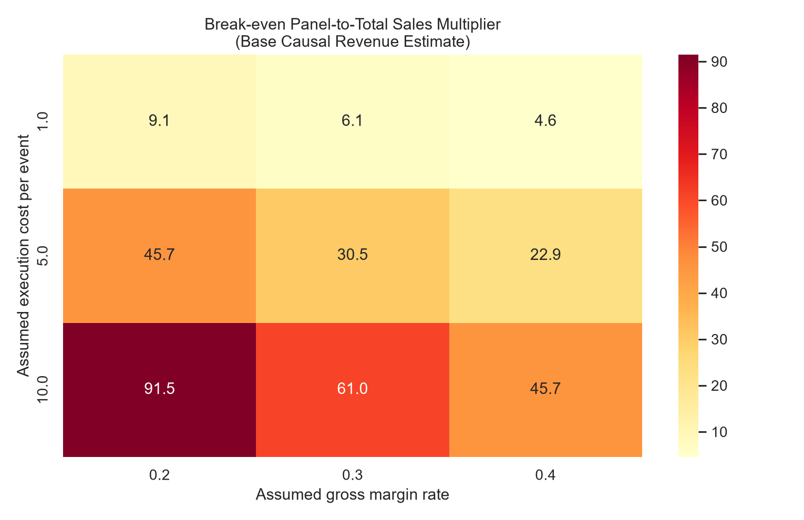

Reproduce the decision layer with:

```powershell
python -m src.commercial_decision_layer
```

Definitions, business interpretation and scenario boundaries are documented in
[`docs/BUSINESS_DECISION_LAYER.md`](docs/BUSINESS_DECISION_LAYER.md).

## Power BI Decision Dashboard

The four-page report lives in [`powerbi/`](powerbi/) as a source-controlled
PBIP project (PBIR report + TMDL semantic model), so every page, visual and DAX
measure is reviewable in Git. Open `powerbi/FMCG.pbip` in Power BI Desktop,
set the `DataFolderPath` parameter to your local `data/powerbi_exports` folder,
then refresh.

| Page | Business question | Evidence type |
|---|---|---|
| Executive Summary | Where does beverage revenue come from, and what should we do next? | Observed + headline decision |
| Customer Growth & Segmentation | Who creates value and do they stay active? | Observed + K-Means |
| Promotion Incrementality | How much lift is plausibly caused by the promotion? | Matched DiD (quasi-experimental) |
| Budget Scenario Planner | Under which cost, margin and scale assumptions does a promotion pay back? | Assumption-only scenario |

Headline story: merchandising adds **+0.36 units (+45%) per product-store
event** (95% CI 0.14-0.65, p = 0.007), but under default cost and margin
assumptions a promotion needs roughly **30x panel-to-store scale** to break
even. The recommendation is a controlled expansion test in carbonated soft
drinks and juice rather than an immediate budget increase.

Every page carries an evidence badge so observed facts, causal estimates and
ROI assumptions are never presented as the same kind of number. Metric and
scenario definitions are in [`powerbi/README.md`](powerbi/README.md).

## BigQuery SQL Analytics Layer

The cloud SQL workflow lives in [`sql/`](sql/). It turns the same processed
inputs into auditable tables for data quality, SQL-native RFM, customer segment
performance, coupon redemption, matched promotion effects and executive KPIs.
Run the scripts in `sql/bigquery/` order after uploading the private local
Parquet inputs. Full table mapping, reconciliation targets and evidence
boundaries are documented in [`sql/README.md`](sql/README.md).

The workflow was executed successfully in BigQuery Sandbox on 2026-10-21 in
the `asia-southeast1` region. All source-contract and key-quality checks passed,
and the final cloud KPI table reconciled to the local Python and Power BI
outputs. See [`outputs/validation/bigquery_cloud_run.md`](outputs/validation/bigquery_cloud_run.md).

This layer intentionally does not calculate profit or claim randomized causal
effects. Actual cost and margin are unavailable, and the matched event panel is
quasi-experimental evidence.

## Causal and Commercial Boundaries

- Descriptive promotion lift is not presented as a causal estimate.
- A causal interpretation requires credible treatment-control comparability, parallel trends and robustness evidence.
- Coupon redemption is a post-treatment customer choice and will not be used naively as the treatment definition.
- Complete product cost and promotion execution cost are unavailable; profit and ROI will therefore be shown only as sensitivity scenarios.
- Demographic profiling is limited because demographics are available for only part of the household panel.

## Imported Baseline

The source project currently contains:

- Python cleaning and transformation modules in `src/`;
- narrative notebooks in `notebooks/`;
- aggregated Power BI exports in `data/powerbi_exports/`;
- charts and presentation assets in `outputs/`;
- a presentation-visual generator in `scripts/`.

The baseline repository reports results such as beverage revenue, promotion share, product lift and household segment summaries. These are inherited reference outputs and are **not yet presented as independently reproduced results in this portfolio**.

## Repository Structure

```text
fmcg-promotion-causal-analytics/
├── data/
│   ├── raw/                        # Local only; not committed
│   ├── processed/                  # Regenerable intermediates
│   ├── local_exports/              # Local household-level Power BI inputs
│   └── powerbi_exports/            # Reviewable aggregate outputs
├── docs/                           # Data dictionaries and method notes
├── notebooks/                      # Baseline narrative notebooks
├── outputs/                        # Charts, validation and presentation assets
├── powerbi/                        # PBIP report + TMDL semantic model
├── scripts/                        # Supporting scripts
├── sql/                            # BigQuery source contract, checks and marts
├── src/                            # Baseline and independent Python modules
├── PROJECT_PLAN.md                 # Portfolio delivery plan
├── THIRD_PARTY_NOTICES.md          # Attribution and data notice
├── requirements.txt
└── README.md
```

Planned additions include `tests/` and `reports/` directories.

## Running the Imported Baseline

The imported baseline was reproduced locally against the current official data
release. Raw and regenerable household-level data remain local.

```powershell
pip install -r requirements.txt

python -m src.data_cleaning
python -m src.beverage_filtering
python -m src.promotion_metrics
python -m src.segmentation
python -m src.kpi_builder
```

Before running, download the Complete Journey CSV files and place them in `data/raw/` as described by the source project.

## Portfolio Evidence Standard

A feature will be described as complete only when the repository contains:

- runnable code or SQL;
- input and output definitions;
- validation checks;
- an interpretable chart or table;
- a written limitation;
- a Git commit showing the work.

## Attribution and License

Selected source code remains subject to the original MIT License and copyright notice. The raw dunnhumby data are governed separately by the data provider's terms and are not redistributed here.

For full details, see [THIRD_PARTY_NOTICES.md](THIRD_PARTY_NOTICES.md).

## Portfolio Author

**Lotus-Yuhan**

Target roles: Data Analyst, Business Analyst and Consumer Insights Analyst.
